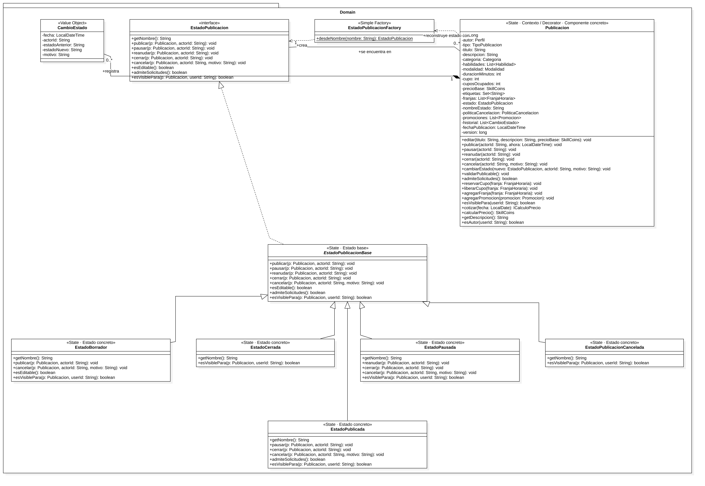
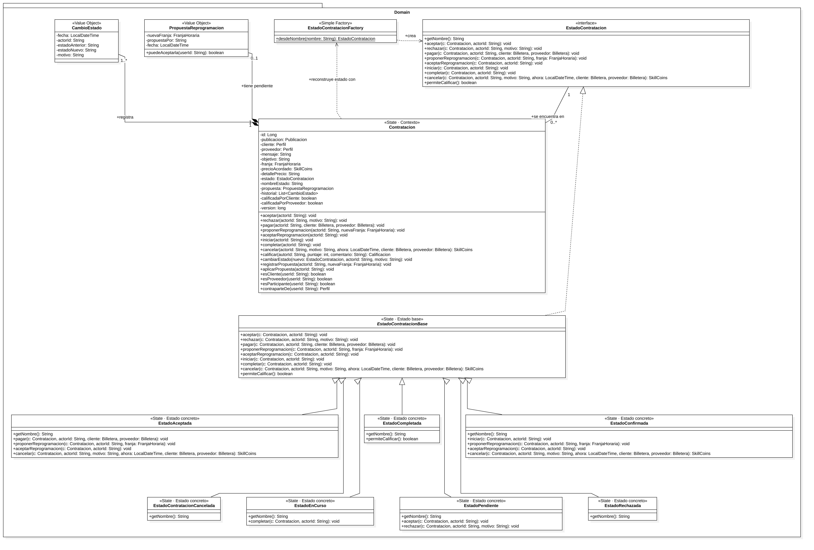
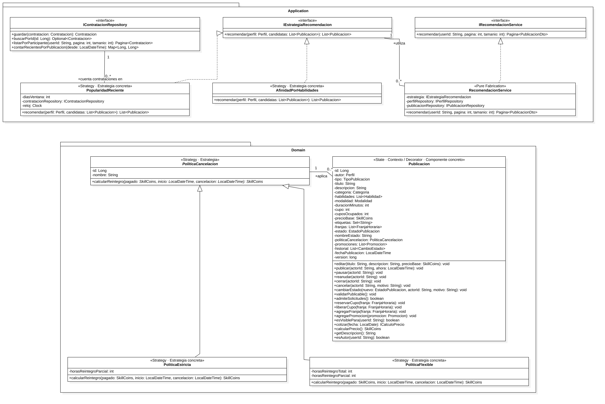
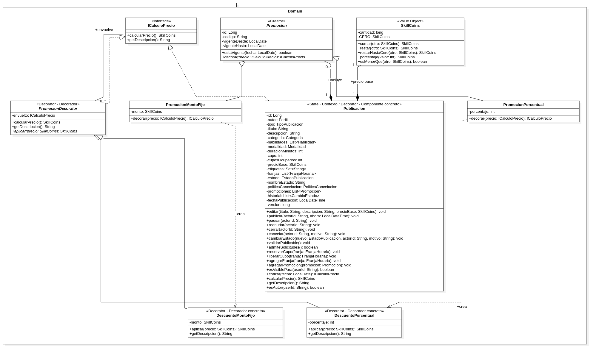
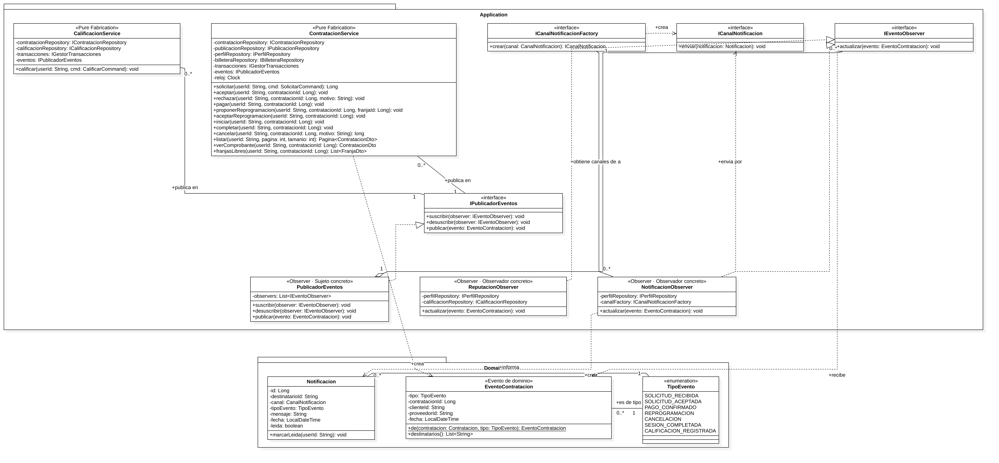
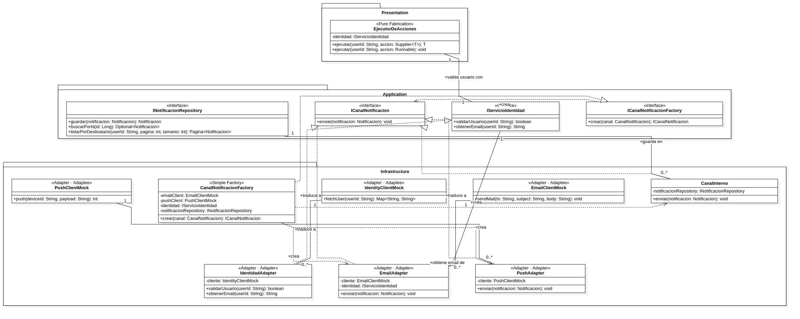
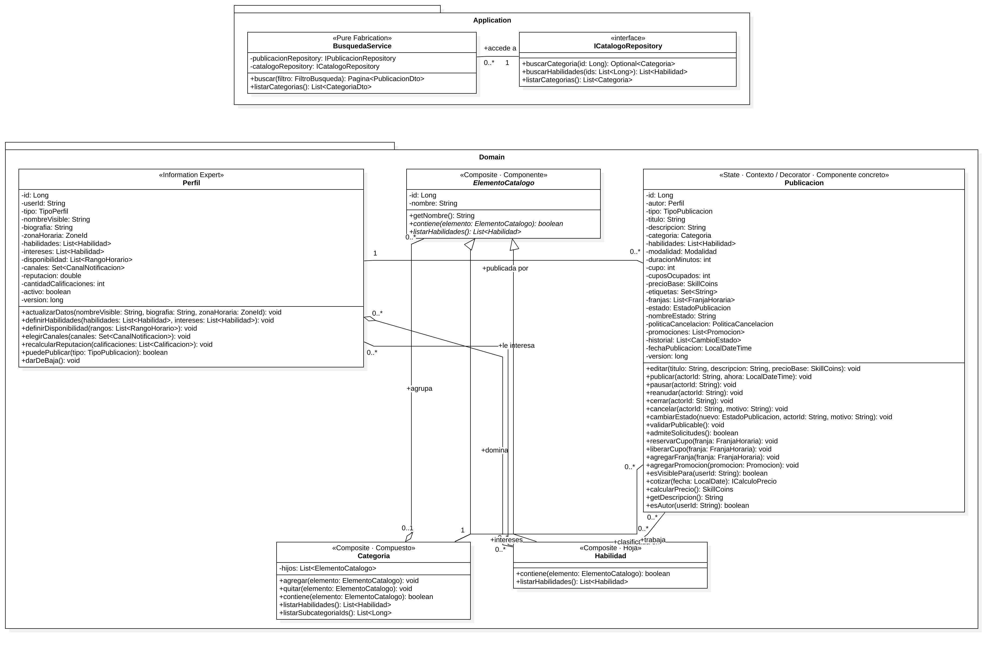
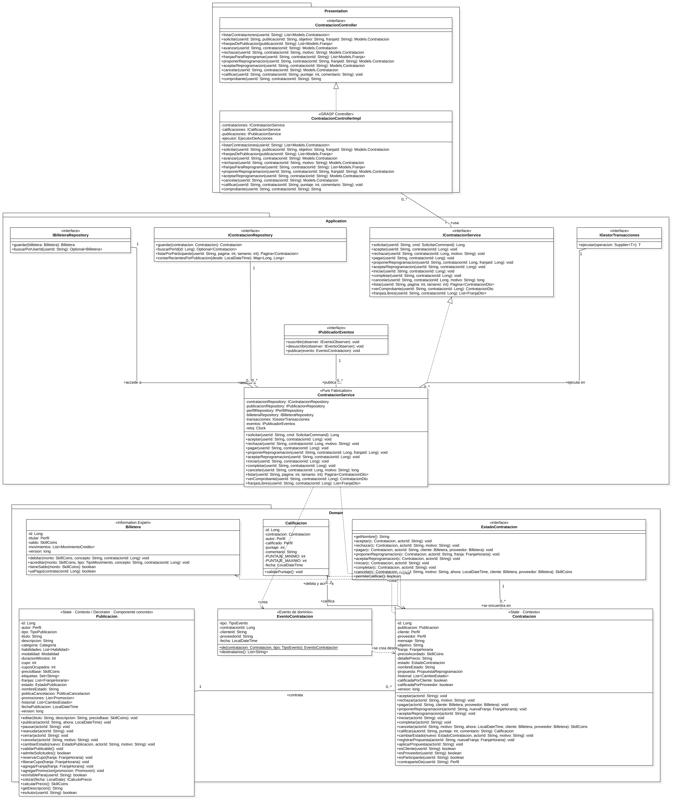
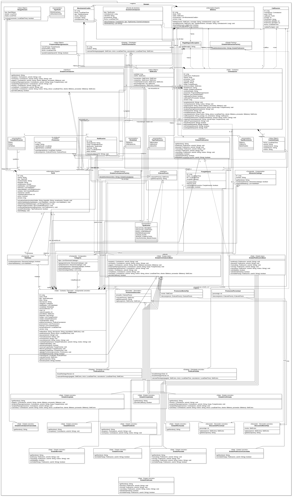

# SkillSwap — Informe de diseño y decisiones

**Trabajo Práctico Obligatorio · Proceso de Desarrollo de Software · UADE · 2C2026**

Integrantes: _completar_

Entregables:

| Archivo | Contenido |
|---|---|
| `src/` y `pom.xml` | Código fuente (dominio, aplicación, infraestructura y presentación) y pruebas |
| `README.md` | Cómo levantar MySQL, correr la aplicación y las pruebas, y la tabla de casos de aceptación contra pruebas |
| `docker-compose.yml` | MySQL local para el modo real |
| `skillswap.mdj` | Modelo UML en StarUML sincronizado con el código: diagrama `Main` completo y 12 vistas, por capa, por patrón y del recorrido principal |
| `informe.pdf` | Este informe: alcance, historias, modelo de dominio, arquitectura, decisiones de diseño y su evidencia en código y pruebas |
| `img/` | Exportación PNG de cada diagrama |

---

## 1. Alcance

El informe cubre el **diseño** (alcance, historias de usuario, modelo de dominio, diagrama de clases, arquitectura y patrones) y su **evidencia en el código y las pruebas** (sección 14). El diagrama `skillswap.mdj` se actualizó con el código final: los nombres de clases, métodos y paquetes coinciden con `src/main/java`.

Queda **fuera de alcance**, como indica la consigna: autenticación real, dinero real, chat o videollamadas, despliegue productivo y diseño visual.

## 2. Supuestos

La consigna deja abiertas algunas decisiones. Estas son las interpretaciones que tomamos:

1. **Cupo y franjas.** El *cupo* es la cantidad máxima de contrataciones activas que admite una publicación. Cada *franja horaria* es un turno concreto, y una franja se reserva para una sola contratación. Por eso, aceptar una solicitud ocupa una franja **y** un cupo.
2. **Pago.** El cliente paga una vez que la solicitud fue aceptada. En ese momento se debita su billetera y se acredita la del proveedor, en una sola transacción. Si después hay una cancelación, el reintegro se mueve en sentido inverso.
3. **Reintegros.** La política de cancelación la elige el autor de la publicación. Se aplica cuando **cancela el cliente**. Si cancela el proveedor, el cliente recibe el 100 %.
4. **Promociones.** Las define el autor sobre su publicación, tienen vigencia y se acumulan. El precio de la contratación queda fijado al solicitarla (precio acordado y su detalle) y no cambia si después cambian las promociones.
5. **Desafíos.** Solo un perfil de tipo `ORGANIZACION` puede publicar un desafío. Las mentorías y los servicios los publica un `PROFESIONAL`.
6. **Identidad.** El `userId` llega desde un servicio de identidad externo, simulado. El perfil guarda ese `userId`, y cada operación que modifica datos lo valida antes de ejecutar.
7. **Notificaciones.** Cada usuario puede elegir **uno o más** canales. Así, un mismo evento puede enviarse por email y además quedar en la bandeja interna (caso de aceptación 8).

## 3. Historias de usuario

| Id | Como… | Quiero… | Para… | Criterios de aceptación |
|---|---|---|---|---|
| HU01 | usuario | crear mi perfil profesional con habilidades, intereses, disponibilidad y canales de aviso | ofrecer y recibir servicios | El `userId` debe existir en identidad. La reputación arranca en 0 y no se puede editar |
| HU02 | visitante | ver un perfil público con reputación, publicaciones activas e historial resumido | decidir a quién contratar | Un perfil dado de baja sigue apareciendo en el historial de otros, pero no publica |
| HU03 | profesional | crear una publicación en borrador y editarla | prepararla antes de mostrarla | Solo se puede editar en BORRADOR |
| HU04 | profesional | publicar, pausar, reanudar, cerrar o cancelar mi publicación | controlar cuándo recibo pedidos | Publicar exige título, categoría, precio ≥ 0 y al menos una franja. Cancelar exige motivo. Una publicación CERRADA no se reabre. Cada cambio queda en el historial |
| HU05 | organización | publicar un desafío | conseguir talento | Solo un perfil `ORGANIZACION` |
| HU06 | cliente | buscar por texto, categoría (con subcategorías), modalidad, precio, habilidad y reputación mínima, ordenar y paginar | encontrar lo que necesito | Paginado siempre. Cuatro criterios de orden |
| HU07 | cliente | recibir recomendaciones | descubrir publicaciones | Hay dos estrategias intercambiables sin tocar el caso de uso |
| HU08 | cliente | solicitar una publicación con mensaje, franja y objetivo | contratar | No puedo solicitar mi propia publicación ni una que no esté PUBLICADA. La franja tiene que estar libre |
| HU09 | proveedor | aceptar o rechazar una solicitud | gestionar mi agenda | Al aceptar se reservan la franja y el cupo de forma transaccional. Dos aceptaciones simultáneas no pueden tomar el último cupo |
| HU10 | cliente | pagar con SkillCoins | confirmar la reserva | Sin saldo negativo ni doble cobro. Si el pago falla, no cambian saldos ni estado |
| HU11 | cualquiera de las partes | proponer y aceptar una reprogramación | mover la sesión | Antes de que empiece. La acepta la otra parte |
| HU12 | cliente o proveedor | cancelar | retirarme | El reintegro se calcula según la política de la publicación (100 %, 50 % o 0 %) |
| HU13 | proveedor | iniciar y completar la sesión | cerrar el servicio | Solo desde CONFIRMADA y EN_CURSO, respectivamente |
| HU14 | participante | calificar una contratación completada | construir reputación | Una vez por participante. No puedo calificarme a mí mismo. La reputación se recalcula |
| HU15 | usuario | recibir avisos por email, push o bandeja interna y marcarlos como leídos | enterarme de los cambios | Seis eventos: solicitud, aceptación, pago, reprogramación, cancelación y sesión completada |
| HU16 | usuario | ver el saldo y los movimientos de mi billetera | controlar mis SkillCoins | — |

## 4. Modelo de dominio

**Entidades:** `Perfil`, `Publicacion`, `FranjaHoraria`, `Contratacion`, `Billetera`, `MovimientoCredito`, `Calificacion`, `Notificacion`, `Promocion`, `PoliticaCancelacion` y el catálogo `Categoria`/`Habilidad`.

**Value objects:**

| Value object | Qué es |
|---|---|
| `SkillCoins` | Monto inmutable, nunca negativo |
| `RangoHorario` | Disponibilidad semanal del perfil |
| `CambioEstado` | Entrada del historial inmutable |
| `PropuestaReprogramacion` | Reprogramación pendiente de aceptación |

**Evento de dominio:** `EventoContratacion`.

### Invariantes y quién las garantiza

Cada regla vive en la clase que tiene la información para verificarla (Information Expert). Si no se cumple, el dominio lanza `ReglaNegocioException`.

| Regla (§5 de la consigna) | Dónde se verifica |
|---|---|
| El autor no puede solicitar su propia publicación | Constructor de `Contratacion` (`publicacion.esAutor(cliente)`) |
| Una publicación no publicada no admite solicitudes | `Publicacion.admiteSolicitudes()`, que delega en su estado: solo `EstadoPublicada` devuelve `true` |
| No reservar una franja ocupada ni superar el cupo | `Publicacion.reservarCupo(franja)` y `FranjaHoraria.ocupar()`. Contra la concurrencia, `@Version` en `Publicacion` |
| Débito y crédito en una única transacción | `Contratacion.pagar(...)` mueve las dos billeteras. `ContratacionService.pagar` lo envuelve en `IGestorTransacciones.ejecutar` |
| Sin saldo negativo ni doble cobro | `SkillCoins.restar` y `Billetera.debitar` (verifican el saldo y `yaPago(contratacionId)`). Además, en la base: `UNIQUE(billetera_id, contratacion_id, tipo)` |
| Reintegro de 100 %, 50 % o 0 % según la anticipación configurable | `PoliticaCancelacion.calcularReintegro(...)` (Strategy) |
| Las promociones nunca producen un total negativo | `PromocionDecorator` sobre `SkillCoins.restarHastaCero` |
| Solo los participantes de una contratación completada califican, una vez | `Contratacion.calificar(...)`: valida el estado, que el autor participe, que no se califique a sí mismo y las banderas `calificadaPorCliente` / `calificadaPorProveedor`. En la base: `UNIQUE(contratacion_id, autor_id)` |
| Cada transición registra fecha, actor y motivo de forma inmutable | `cambiarEstado(...)` en `Publicacion` y en `Contratacion` agrega un `CambioEstado`. El historial no tiene setters ni se borra |
| La baja de un perfil es lógica | `Perfil.darDeBaja()` pone `activo = false`. No hay borrado físico |
| La reputación no se edita a mano | `Perfil` no tiene setter de reputación. Solo `recalcularReputacion(calificaciones)` |
| Las transiciones inválidas se rechazan | `EstadoPublicacionBase` y `EstadoContratacionBase` lanzan en toda acción que el estado concreto no redefine |

## 5. Arquitectura

Se respeta la **regla de dependencias de Clean Architecture**: todas las flechas apuntan hacia el dominio. En el modelo, cada capa es un paquete UML (`Presentation`, `Application`, `Infrastructure` y `Domain`, como en la resolución del final 15).

| Capa | Contiene | Depende de |
|---|---|---|
| **Domain** | Entidades, value objects, estados (State), políticas (Strategy), promociones (Decorator), catálogo (Composite) y eventos | Nada: no conoce JPA salvo las anotaciones de mapeo, ni la UI ni los proveedores |
| **Application** | Casos de uso (`I…Service` y su implementación), comandos, DTOs, puertos de salida (`I…Repository`, `IGestorTransacciones`, `IServicioIdentidad`, `ICanalNotificacion`, `ICanalNotificacionFactory`), Observer y estrategias de recomendación | Domain |
| **Infrastructure** | Repositorios JPA, gestor de transacciones, adapters de identidad, email y push (mock), canal interno y la Simple Factory de canales | Application (implementa sus puertos) y Domain |
| **Presentation** | Controllers (las interfaces del Mock UI Kit y sus implementaciones `…ControllerImpl`), `EjecutorDeAcciones`, `ErrorDeAplicacion` y `Conversor` | Application (solo interfaces de servicio y DTOs) |

### Decisiones de arquitectura

- **Composition root.** Sin Spring, `ConfiguracionApp` arma el publicador con sus observers, los servicios y los controllers a partir de los puertos de salida ya construidos; `SkillSwapApplication` crea los repositorios JPA, los adapters y la factory (modo `--real`) y se los pasa. Son los únicos lugares que conocen todas las clases concretas. También es donde se elige la estrategia de recomendación.
- **La UI conoce solo las interfaces de controller del kit** (`UiControllers` y sus seis controllers). Nunca ve repositorios ni entidades: los controllers devuelven los registros de la UI (`Models`) y, ante un error, lanzan `ErrorDeAplicacion` con un mensaje legible.
- **CQRS liviano.**
  - Los casos de uso de comando (publicar, aceptar, pagar, etc.) cargan el agregado y dejan que el dominio decida.
  - Las consultas (búsqueda, recomendaciones, perfil público, bandeja, billetera) devuelven DTOs y `Pagina<T>`, con proyecciones JPQL y `JOIN FETCH`.
  - El orden (`CriterioOrden`) se resuelve como `ORDER BY` en la consulta. No justifica un patrón propio.
- **Transacciones en Application.** `IGestorTransacciones.ejecutar(...)` delimita aceptar, pagar, cancelar, reprogramar y calificar. La implementación JPA hace commit o rollback, de modo que un pago fallido no deja saldos ni estados a medias.
- **Errores uniformes.**
  - El dominio lanza `ReglaNegocioException`.
  - La aplicación lanza `RecursoNoEncontradoException` o `AccesoDenegadoException`.
  - La infraestructura lanza `ConflictoConcurrenciaException` cuando `@Version` detecta que otra operación se llevó el mismo dato (por ejemplo el último cupo).
  - `EjecutorDeAcciones`, una Pure Fabrication de la capa de presentación, valida el `userId` contra identidad, ejecuta la acción y traduce esas excepciones a `ErrorDeAplicacion(mensaje)`. Así los controllers quedan en una línea por método.

## 6. Patrones de diseño

La consigna pide al menos cuatro patrones, justificados por variaciones reales. Aplicamos siete, cada uno atado a un punto concreto de la consigna. Abajo están los que **descartamos** y por qué.

| # | Variación de la consigna | Patrón | GRASP / SOLID | Vista en el `.mdj` |
|---|---|---|---|---|
| 1 | Estados y transiciones de la publicación (§4.2) | **State** | Polymorphism, Protected Variations, OCP, SRP | *Patron State - Publicacion* |
| 2 | Estados y transiciones de la contratación (§4.5) | **State** | ídem | *Patron State - Contratacion* |
| 3 | Política de reintegro 100/50/0 % y dos políticas distintas (§5, §15) | **Strategy** | Polymorphism, OCP | *Patron Strategy* |
| 4 | Recomendación intercambiable: afinidad y popularidad (§4.3) | **Strategy** | Polymorphism, Protected Variations, OCP, DIP | *Patron Strategy* |
| 5 | Promociones acumulables sin total negativo (§5) | **Decorator** | OCP, SRP, Creator | *Patron Decorator* |
| 6 | Eventos que notifican a varios interesados (§4.6) | **Observer** | Low Coupling, Indirection, OCP, DIP | *Patron Observer* |
| 7 | Identidad externa y proveedores de email y push reemplazables (§4.1, §4.6) | **Adapter** | Indirection, Protected Variations, DIP | *Patron Adapter y Simple Factory* |
| 8 | Elegir el canal según la preferencia del usuario y reconstruir el estado persistido | **Simple Factory** | Creator, Pure Fabrication, Protected Variations | *Patron Adapter y Simple Factory*, *Patron State* |
| 9 | Catálogo jerárquico: buscar por categoría incluye las subcategorías | **Composite** | Polymorphism, OCP | *Patron Composite* |

### 6.1 State — Publicación y Contratación

- **Problema.** Las dos entidades tienen un ciclo de vida con acciones válidas distintas en cada estado (las tablas de §4.2 y §4.5). Con un `String` o un `enum` de estado, cada método termina en un `if/switch` que crece con cada estado nuevo: viola OCP y deja métodos largos.
- **Alternativa elegida.** Es la misma estructura que Magic Café (`EstadoPedido` / `EstadoPedidoBase`):
  - Las interfaces `EstadoPublicacion` y `EstadoContratacion`.
  - Una clase base abstracta (`EstadoPublicacionBase`, `EstadoContratacionBase`) donde **toda** acción lanza `ReglaNegocioException("transición inválida")`.
  - Un estado concreto por fila de la tabla, que redefine solo las acciones válidas. Por ejemplo, `EstadoAceptada` redefine `pagar`, `cancelar`, `proponerReprogramacion` y `aceptarReprogramacion`.
  - El contexto (`Publicacion`, `Contratacion`) delega: `contratacion.pagar(...)` llama a `estado.pagar(this, ...)`. El estado concreto ejecuta la regla y llama a `c.cambiarEstado(new EstadoConfirmada(), actor, motivo)`. `cambiarEstado` deja el `CambioEstado` en el historial.
- **Persistencia.** Como en Magic Café, se guarda `nombreEstado` (String). El objeto estado es `@Transient` y se reconstruye en `@PostLoad` con `EstadoXFactory.desdeNombre(...)` (Simple Factory).
- **Consecuencias.**
  - (+) Agregar un estado es agregar una clase. Las transiciones inválidas se rechazan solas, por defecto.
  - (−) Hay más clases, y la factory de reconstrucción tiene que actualizarse con cada estado nuevo.
- **Evidencia.** Pruebas unitarias por estado: cada acción válida transiciona y cada acción inválida lanza. Por ejemplo, `pagar` en PENDIENTE lanza, y una publicación CERRADA no se puede reabrir.

### 6.2 Strategy — Política de cancelación

- **Problema.** El reintegro depende de la anticipación, y la consigna pide calcularlo "con dos políticas diferentes". Un `if` por política en `Contratacion` mezclaría las reglas y obligaría a modificar la entidad con cada política nueva.
- **Alternativa elegida.** `PoliticaCancelacion` es una clase abstracta con `calcularReintegro(pagado, inicio, cancelacion)`. Las concretas son:
  - `PoliticaFlexible`: 100 % con ≥ 24 h de anticipación, 50 % con ≥ 2 h y 0 % si no.
  - `PoliticaEstricta`: 50 % con ≥ 72 h y 0 % si no.

  Los umbrales son atributos, así que son configurables. Se persiste como entidad `SINGLE_TABLE` con discriminador, igual que `DescuentoStrategy` en Magic Café. Cada `Publicacion` referencia la suya. *"La selección ocurre fuera (el autor elige al publicar); la ejecución, dentro (`Contratacion.cancelar`)."*
- **Consecuencias.** (+) Hay políticas nuevas sin tocar `Contratacion`. (−) Para elegirla hay que referenciarla por id.
- **Evidencia.** Pruebas parametrizadas por política y por anticipación (borde de 24 h, 2 h y 72 h), más el caso de aceptación 6.

### 6.3 Strategy — Recomendación

- **Problema.** La consigna pide al menos dos estrategias **intercambiables** y que cambiar de estrategia no modifique el caso de uso consumidor (§15.7).
- **Alternativa elegida.**
  - `IEstrategiaRecomendacion.recomendar(perfil, candidatas)`.
  - `AfinidadPorHabilidades` puntúa por la coincidencia entre las habilidades de la publicación y los intereses del perfil.
  - `PopularidadReciente` ordena por contrataciones en los últimos `diasVentana` días, usando el puerto `IContratacionRepository`.
  - `RecomendacionService` tiene un atributo `estrategia: IEstrategiaRecomendacion` que se inyecta en el composition root.
  - Las estrategias van en Application porque necesitan puertos de consulta. Así se evita el error de la resolución del final 15, donde el dominio dependía de interfaces de Application.
- **Consecuencias.** (+) Hay una estrategia nueva sin tocar el servicio. (−) La popularidad requiere una consulta agregada (`contarRecientesPorPublicacion`).
- **Evidencia.** El mismo test del servicio corre con las dos estrategias y con un *stub*, sin cambiar el servicio.

### 6.4 Decorator — Promociones acumulables

- **Problema.** Las promociones se pueden combinar: un porcentaje más un monto fijo, en cualquier orden y cantidad. Una subclase por combinación es una explosión de clases, y un `if` por tipo de promoción viola OCP. Además, el total nunca puede ser negativo.
- **Alternativa elegida.**
  - `ICalculoPrecio` es el componente y `Publicacion` es el componente concreto: devuelve su `precioBase`, igual que `Vendible implements ItemVendible`.
  - `PromocionDecorator` es abstracto y envuelve un `ICalculoPrecio`. Su `calcularPrecio()` devuelve `aplicar(envuelto.calcularPrecio())`.
  - Los decoradores concretos son `DescuentoPorcentual` y `DescuentoMontoFijo`. Como `SkillCoins` nunca es negativo (`restarHastaCero`), ninguna cadena produce un total negativo.
  - Las promociones se **persisten** como datos (`Promocion` abstracta, `SINGLE_TABLE`, con vigencia). Cada subclase **crea** su decorador (`decorar(precio)`) porque tiene los datos para inicializarlo (GRASP Creator).
  - `Publicacion.cotizar(fecha)` arma la cadena con las promociones vigentes. `Contratacion` guarda el resultado como foto (`precioAcordado` y `detallePrecio`), igual que `ItemPedido` en Magic Café.
- **Consecuencias.**
  - (+) Una promoción nueva es una subclase de `Promocion` más un decorador. El precio se compone en tiempo de ejecución.
  - (−) Hay muchos objetos pequeños encadenados, más difíciles de depurar. Lo mitiga `getDescripcion()`, que arma el detalle legible.
- **Evidencia.** Pruebas de combinación y de piso cero: 30 % + 500 sobre 400 da 0, nunca negativo (caso de aceptación 9).

### 6.5 Observer — Eventos y notificaciones

- **Problema.** Seis eventos de la contratación tienen que avisar a las partes por los canales que cada una eligió, y la calificación tiene que disparar el recálculo de la reputación. Si `ContratacionService` llamara directamente a cada canal y a la reputación, quedaría acoplado a todos los interesados, y cada interesado nuevo modificaría el servicio.
- **Alternativa elegida.** Es la variante de Netflix, con el publicador en Application:
  - `IPublicadorEventos` (sujeto: `suscribir`, `desuscribir`, `publicar`) e `IEventoObserver.actualizar(evento)`.
  - Los observadores concretos son:
    - `NotificacionObserver`: arma la `Notificacion` para cada destinatario del evento y la envía por cada canal preferido, usando la factory.
    - `ReputacionObserver`: ante `CALIFICACION_REGISTRADA`, recalcula la reputación del calificado.
  - El evento (`EventoContratacion`) es de dominio y sabe quiénes son sus destinatarios (Information Expert).
- **Consecuencias.**
  - (+) Un interesado nuevo, por ejemplo métricas, no toca los servicios.
  - (−) El flujo es menos explícito. Se publica **después** de que la transacción confirma, para no notificar operaciones que hicieron rollback.
- **Evidencia.** Prueba con dos observers falsos que reciben el mismo evento, y caso de aceptación 8: dos canales mock reciben el mismo evento.

### 6.6 Adapter — Identidad, email y push

- **Problema.** Los proveedores reales se simulan, pero "deben conectarse mediante interfaces reemplazables" (§4.6). Sus APIs, por ejemplo `fetchUser(...)`, `sendMail(to, subject, body)` y `push(deviceId, payload)`, no coinciden con lo que necesita la aplicación, y no se pueden modificar.
- **Alternativa elegida.** Es la estructura de `ProcesadorPago` / `PasarelaPagoAdapter` / `PasarelaPagoLegacy`:
  - Los **Targets** son puertos propios en Application: `IServicioIdentidad` e `ICanalNotificacion`.
  - Los **Adapters** están en Infrastructure: `IdentidadAdapter`, `EmailAdapter` y `PushAdapter`. Cada uno guarda una referencia al Adaptee y traduce.
  - Los **Adaptees** son mocks del SDK externo: `IdentityClientMock`, `EmailClientMock` y `PushClientMock`.
  - `CanalInterno` implementa el mismo puerto pero no adapta nada: guarda la notificación en la bandeja.
  - **Descartado:** un Adapter para la "pasarela de SkillCoins". Los créditos son internos y no hay un proveedor que pueda cambiar; un Adapter ahí sería un patrón sin variación que resolver.
- **Consecuencias.** (+) Cambiar el mock por un proveedor real es escribir otro Adapter, sin tocar Application. (−) Hay una clase de traducción por proveedor.
- **Evidencia.** Pruebas de cada adapter contra su mock (traducción de parámetros) y pruebas de casos de uso con puertos falsos.

### 6.7 Simple Factory — Canales y reconstrucción de estados

- **Problema 1.** `NotificacionObserver` necesita un canal por cada `CanalNotificacion` preferido, pero Application no puede conocer los adapters concretos.
- **Solución 1.** El puerto `ICanalNotificacionFactory.crear(canal)` lo implementa `CanalNotificacionFactory` en Infrastructure, con un único `switch`, que es la definición de Simple Factory de la cátedra. Agregar un canal toca solo la factory y el adapter nuevo.
- **Problema 2.** El estado se persiste como texto.
- **Solución 2.** `EstadoPublicacionFactory.desdeNombre` y `EstadoContratacionFactory.desdeNombre` reconstruyen el objeto estado en `@PostLoad`, como `EstadoPedidoFactory`.
- **Consecuencias.** (+) La creación queda centralizada. (−) El `switch` de la factory cambia con cada canal o estado nuevo. Es el único lugar que cambia, y está aislado.

### 6.8 Composite — Catálogo de categorías y habilidades

- **Problema.** La consigna pide incorporar categorías nuevas y buscar por categoría. Con categorías anidadas (por ejemplo *Tecnología → Arquitectura → Microservicios*), buscar "Tecnología" tiene que incluir todo lo que está debajo, sin que el buscador recorra niveles con `if`.
- **Alternativa elegida.** El componente abstracto `ElementoCatalogo` declara `contiene(elemento)` y `listarHabilidades()`. `Categoria` es el compuesto: agrega hijos y delega en ellos. `Habilidad` es la hoja. `BusquedaService` le pide a la categoría `listarSubcategoriaIds()` y filtra por esos ids. Se persiste como `SINGLE_TABLE` con una autorreferencia al padre.
- **Consecuencias.** (+) La profundidad es libre y el cliente trata igual una hoja que un compuesto. (−) La consulta recursiva conviene cachearla, porque el catálogo cambia poco.
- **Evidencia.** Pruebas de `contiene` y `listarHabilidades` con tres niveles, y búsqueda filtrada que encuentra una publicación de una subcategoría (caso de aceptación 1).

### 6.9 Patrones evaluados y descartados

| Patrón | Por qué no |
|---|---|
| **Facade** | El perfil público y el checkout ya los coordina un caso de uso (`PerfilService.verPerfil`, `ContratacionService.pagar`). Una Facade encima duplicaría al servicio sin ocultar ningún subsistema adicional. Se reconsidera si la UI necesita una vista que combine varios servicios |
| **Singleton** | No hay ninguna instancia única obligatoria: el composition root crea una sola instancia de cada servicio sin forzarlo, y un Singleton complicaría las pruebas, porque es estado global |
| **Strategy de orden** | Los cuatro órdenes son `ORDER BY` de la consulta: un `enum CriterioOrden` alcanza y es más eficiente que ordenar en memoria |
| **Abstract Factory** | No hay familias de objetos que deban crearse juntas |
| **Adapter de pasarela de SkillCoins** | Ver 6.6 |

## 7. Principios SOLID

| Principio | Dónde se evidencia |
|---|---|
| **SRP** | Cada caso de uso es un servicio por módulo. Cada estado, política, decorador y adapter tiene una sola razón para cambiar. `EjecutorDeAcciones` concentra el manejo de errores y los controllers solo delegan |
| **OCP** | Estados, políticas, estrategias de recomendación, promociones, canales y observers nuevos se agregan **como clases nuevas**, sin modificar contextos ni servicios |
| **LSP** | Todo `EstadoContratacion` respeta el contrato: o ejecuta la transición o lanza `ReglaNegocioException`, nunca otra cosa. Cualquier `ICalculoPrecio` devuelve `SkillCoins` no negativo. Las dos estrategias de recomendación devuelven un subconjunto ordenado de las candidatas |
| **ISP** | Un puerto pequeño por responsabilidad: un repositorio por agregado, `ICanalNotificacion` con un solo método e `IServicioIdentidad` con dos. Una interfaz de controller por módulo de la UI |
| **DIP** | Los casos de uso dependen de interfaces de Application. Infrastructure las implementa y el composition root las inyecta por constructor |

## 8. Principios GRASP

| GRASP | Dónde |
|---|---|
| **Controller** | `…Controller` recibe la acción de la UI y delega en un caso de uso. No tiene SQL ni reglas |
| **Information Expert** | `Billetera` valida el saldo y el doble cobro. `Publicacion` valida si es publicable y el cupo. `Contratacion` valida quién califica. `EventoContratacion` sabe sus destinatarios. `Perfil` recalcula su reputación |
| **Creator** | `Contratacion.calificar()` crea la `Calificacion`, porque tiene los datos para verificarla. `Promocion.decorar()` crea su decorador. `ContratacionService` crea la `Contratacion` a partir del comando |
| **Pure Fabrication** | Servicios de aplicación, repositorios, `PublicadorEventos` y `EjecutorDeAcciones` |
| **Polymorphism** | State, Strategy, Decorator y Composite reemplazan los condicionales por tipo |
| **Indirection / Protected Variations** | Puertos de repositorio, Adapters de proveedores e `ICanalNotificacionFactory` |
| **Low Coupling / High Cohesion** | Los colaboradores se conocen por interfaz, y Observer desacopla a los emisores de los interesados |

## 9. Persistencia

- **Stack.** Hibernate 7 / JPA 3.2 y MySQL 8.4 (docker), `persistence.xml` `RESOURCE_LOCAL`, sin Spring. Las migraciones versionadas van con **Flyway** (`V1__esquema.sql`, `V2__datos_demo.sql`), sin `ddl-auto=create`.
- **Herencia JPA.** `SINGLE_TABLE` con discriminador para `PoliticaCancelacion`, `Promocion` y `ElementoCatalogo`. Las jerarquías son chicas y con pocas columnas propias, así que se evitan los joins. El costo son algunas columnas nulas.
- **Embebidos.** `SkillCoins` (`@Embeddable`), `RangoHorario`, `PropuestaReprogramacion` y `CambioEstado`. El historial va como `@ElementCollection` en tablas `publicacion_historial` y `contratacion_historial`, solo de inserción.
- **Relaciones.**
  - `Publicacion 1–N FranjaHoraria` y `Publicacion 1–N Promocion` son `@OneToMany(cascade = ALL, orphanRemoval = true)`.
  - `Contratacion N–1 Publicacion`, `Contratacion N–1 Perfil` (cliente y proveedor) y `Calificacion N–1 Contratacion` son `@ManyToOne(LAZY)`.
  - `Perfil N–M Habilidad` (habilidades e intereses) son `@ManyToMany` con tablas intermedias.
- **Restricciones e índices.**
  - `UNIQUE(perfil.user_id)`.
  - `UNIQUE(calificacion.contratacion_id, autor_id)`.
  - `UNIQUE(movimiento.billetera_id, contratacion_id, tipo)` contra el doble cobro.
  - Índices en `publicacion(estado, categoria_id)`, `publicacion(precio)`, `publicacion(fecha_publicacion)`, `contratacion(cliente_id)`, `contratacion(proveedor_id)` y `notificacion(destinatario_id, leida)`.
- **Concurrencia.** `@Version` en `Publicacion`, `Contratacion` y `Billetera` (optimistic locking). Si dos proveedores aceptan a la vez la última plaza, el segundo commit falla con `OptimisticLockException`. `JpaGestorTransacciones` hace rollback y la traduce a `ConflictoConcurrenciaException`, y `EjecutorDeAcciones` la muestra en la UI como "Cupo agotado o publicación modificada por otra operación, reintente" (caso de aceptación 4). Al reintentar, el dominio responde "cupo agotado".
- **Límites transaccionales.** Una transacción por cada operación de aceptar (reserva), pagar, cancelar (reintegro y liberación de cupo), reprogramar y calificar (con el recálculo de reputación).
- **N+1.**
  - Los listados (búsqueda, publicaciones propias, contrataciones) traen autor, categoría, cliente, proveedor y franja con `JOIN FETCH` (relaciones a uno) y se paginan con `setFirstResult` y `setMaxResults` más un `COUNT` aparte. Los DTO se arman fuera de la transacción con lo que trajo ese fetch plan.
  - Las colecciones del perfil (habilidades, intereses, disponibilidad) se inicializan dentro de la misma transacción, porque Hibernate no hace `JOIN FETCH` de dos listas a la vez.
  - Las colecciones son `LAZY` por defecto. Esto evita también el `EAGER` generalizado que usa Magic Café para esquivar `LazyInitializationException`.
- **Datos de demostración.** Hay perfiles, categorías en tres niveles, publicaciones en cada estado, billeteras con saldo y dos políticas de cancelación, todo cargado por Flyway.

## 10. Controllers

Son clases Java simples, sin HTTP. Los controllers son los de la Mock UI Kit: la cátedra entrega las interfaces (`UiControllers` con `BusquedaController`, `PublicacionController`, `ContratacionController`, `WalletController`, `NotificacionController` y `PerfilController`) y este proyecto implementa los adaptadores `…ControllerImpl` sobre los casos de uso. El kit devuelve valores y comunica los errores con excepciones, por eso no hay un tipo `Resultado<T>`: el error llega como `ErrorDeAplicacion`. Cada método sigue el mismo patrón:

```java
public Contratacion cancelar(String userId, String contratacionId) {
    return ejecutor.ejecutar(userId, () -> {
        Long id = Conversor.id(contratacionId);
        contrataciones.cancelar(userId, id, "Cancelada desde la aplicacion");
        return ver(userId, id);
    });
}
```

- **Entradas.** Los casos de uso reciben *command objects* (`SolicitarCommand`, `PublicacionCommand`, etc.); el controller arma el comando a partir de los parámetros simples de la UI.
- **Salidas.** Los casos de uso devuelven `Pagina<T>` y la UI recibe listas de los registros de `Models`.
- **Brechas con la UI del kit.** La UI no expone crear perfil (ese caso de uso se ejercita desde las pruebas). Sí expone calificar, rechazar, proponer y aceptar una reprogramación, elegir el horario al solicitar, agregar promociones, elegir la política de cancelación y editar perfil y borradores. Ofrece además la modalidad `HIBRIDA` que el dominio no tiene, y tiene un único botón "avanzar" que cada controller traduce al caso de uso según el estado y el rol.

## 11. Recorrido del caso de uso principal sobre el UML

Corresponde a la vista *Recorrido principal*: publicar → solicitar → aceptar → pagar → completar → calificar.

1. **Publicar.**
   - `PublicacionControllerImpl.cambiarEstado(userId, id, PUBLICADA)` llama a `EjecutorDeAcciones`, que valida el `userId` con `IServicioIdentidad`, y luego a `PublicacionService.cambiarEstado`.
   - El servicio carga la publicación y ejecuta `AccionPublicacion.PUBLICAR.ejecutar(publicacion, ...)`, que llama a `publicacion.publicar(actor, ahora)`.
   - `EstadoBorrador.publicar` llama a `validarPublicable()` y a `cambiarEstado(new EstadoPublicada())`, que deja un `CambioEstado` en el historial.
2. **Solicitar.**
   - `ContratacionService.solicitar` verifica `publicacion.admiteSolicitudes()` (solo en PUBLICADA), que el cliente no sea el autor y que la franja esté libre.
   - Luego llama a `publicacion.cotizar(hoy)`, que arma la cadena de decoradores, y crea la `Contratacion` en PENDIENTE con el `precioAcordado`.
   - Publica `SOLICITUD_RECIBIDA`. `NotificacionObserver` avisa al proveedor por sus canales, usando `CanalNotificacionFactory` y luego `EmailAdapter` (con `EmailClientMock`) o `CanalInterno`.
3. **Aceptar.** Dentro de una transacción, `contratacion.aceptar(proveedor)` llama a `EstadoPendiente.aceptar`, que ejecuta `publicacion.reservarCupo(franja)` y pasa a ACEPTADA. El commit verifica `@Version`. Después se publica `SOLICITUD_ACEPTADA`.
4. **Pagar.** Dentro de una transacción, `contratacion.pagar(cliente, billeteraCliente, billeteraProveedor)` llama a `EstadoAceptada.pagar`. Ahí `billeteraCliente.debitar(...)` (que verifica el saldo y que no esté pagado) y `billeteraProveedor.acreditar(...)`, y la contratación pasa a CONFIRMADA. Después se publica `PAGO_CONFIRMADO`.
5. **Iniciar y completar.** `EstadoConfirmada.iniciar` pasa a EN_CURSO y `EstadoEnCurso.completar` pasa a COMPLETADA. Se publica `SESION_COMPLETADA`.
6. **Calificar.**
   - `CalificacionService.calificar` llama a `contratacion.calificar(autor, puntaje, comentario)`. Esa operación verifica `permiteCalificar()` (solo en COMPLETADA), que el autor participe, que no se califique a sí mismo y que no haya calificado antes, y crea la `Calificacion`.
   - Se publica `CALIFICACION_REGISTRADA`, y `ReputacionObserver` llama a `perfil.recalcularReputacion(calificaciones)`.

## 12. Casos de aceptación y pruebas

| Caso (§15) | Prueba | Clases de prueba |
|---|---|---|
| 1. Publicar y encontrar por búsqueda filtrada | Caso de uso con puertos en memoria y con JPA: se publica una mentoría y se la encuentra por categoría padre y filtros combinados | `BusquedaServiceTest`, `PublicacionServiceTest`, `ServiciosConJpaTest` |
| 2. Rechazar una oferta incompleta | `publicar()` sin franjas o sin categoría lanza y la publicación queda en BORRADOR | `PublicacionTest`, `PublicacionServiceTest`, `ServiciosConJpaTest` |
| 3. Solicitar, aceptar y pagar con saldo suficiente | Los saldos se mueven y el estado queda en CONFIRMADA, con puertos falsos y sobre JPA | `ContratacionServiceTest`, `ContratacionJpaTest`, `RecorridoPrincipalTest` |
| 4. Dos aceptaciones no consumen el último cupo | Dos hilos con su propio `EntityManager`: el segundo falla por `@Version` y el cupo queda en 1 (también sobre MySQL) | `ContratacionServiceTest`, `ConcurrenciaCupoTest` |
| 5. Pago con saldo insuficiente no modifica nada | Lanza, los saldos quedan iguales y el estado sigue en ACEPTADA | `BilleteraTest`, `ContratacionServiceTest`, `ContratacionJpaTest` |
| 6. Reintegro con dos políticas | Parametrizadas de `PoliticaFlexible` y `PoliticaEstricta`, y la misma cancelación con las dos políticas en el caso de uso | `PoliticaCancelacionTest`, `ContratacionServiceTest`, `ContratacionJpaTest` |
| 7. Cambiar la recomendación sin tocar el caso de uso | `RecomendacionService` con cada estrategia y con un *stub* | `RecomendacionServiceTest`, `ServiciosConJpaTest` |
| 8. Dos tipos de notificación ante un mismo evento | Un perfil con EMAIL e INTERNA: el mock de email y la bandeja reciben el mismo evento | `ObserverTest`, `ServiciosConJpaTest` |
| 9. Promociones acumulables sin precio negativo | Decoradores encadenados con piso cero | `PromocionDecoratorTest` |
| 10. Completar, calificar una sola vez y recalcular la reputación | La segunda calificación lanza y la reputación cambia | `CalificacionServiceTest`, `RecorridoPrincipalTest` |

El recorrido completo (publicar, solicitar, aceptar, pagar, completar, calificar) lo ejecuta `RecorridoPrincipalTest` de punta a punta: controllers de la UI, casos de uso y JPA sobre H2 con las migraciones de Flyway. El `README.md` lista la prueba exacta de cada caso.

**Casos negativos obligatorios:** transición inválida, saldo insuficiente, cupo agotado, doble pago y calificación no autorizada. Todos tienen una prueba que espera la excepción correspondiente (`PublicacionTest`, `BilleteraTest`, `ConcurrenciaCupoTest`, `ContratacionJpaTest`, `CalificacionServiceTest`). La cobertura de líneas medida con JaCoCo es de 99,2 % en dominio y 99,2 % en aplicación (mínimo exigido: 80 %; `mvn verify` falla por debajo).

## 13. Diagramas

El archivo `skillswap.mdj` contiene **150 clasificadores y 240 relaciones**:

- **Clases:** atributos privados y operaciones públicas, con tipos y retorno.
- **Relaciones:** asociaciones con nombre verbal y multiplicidad en ambos extremos.
- **Patrones:** cada clase que cumple un rol de patrón lleva un **estereotipo** con el patrón y el rol (por ejemplo «State · Estado concreto»). El rol de las interfaces está en su documentación.

| Diagrama | Contenido |
|---|---|
| `Main` | Modelo completo, con las cuatro capas como paquetes |
| `Capa Dominio`, `Capa Aplicacion`, `Capa Infraestructura`, `Capa Presentacion` | Una capa por vista, junto con los puertos que implementa o usa |
| `Patron State - Publicacion`, `Patron State - Contratacion`, `Patron Strategy`, `Patron Decorator`, `Patron Observer`, `Patron Adapter y Simple Factory`, `Patron Composite` | Un patrón por vista |
| `Recorrido principal` | Las clases que intervienen en el recorrido de la sección 11 |

<div class="figuras">



















</div>

## 14. Evidencia en el código y las pruebas, por decisión

Rutas de código bajo `src/main/java/ar/edu/uade/skillswap/` y de pruebas bajo `src/test/java/ar/edu/uade/skillswap/`.

| Decisión | Evidencia en el código | Evidencia en las pruebas |
|---|---|---|
| Clean Architecture: dependencias hacia el dominio | `application` no importa `infrastructure` ni `presentation`, y `domain` no importa `application`; los puertos están en `application/port` y los implementa `infrastructure` | `ComposicionJpaTest` arma todo con JPA y `SkillSwapControllersTest` con repositorios en memoria, sin tocar los casos de uso |
| State (publicación y contratación) | `domain/estado/publicacion`, `domain/estado/contratacion` | `PublicacionTest`, `ContratacionTest`, `EstadoFactoryTest` (cada acción válida transiciona, cada inválida lanza) |
| Strategy: política de cancelación | `domain/politica` | `PoliticaCancelacionTest`, `ContratacionServiceTest` |
| Strategy: recomendación | `application/recomendacion`, `RecomendacionService` | `RecomendacionServiceTest` |
| Decorator: promociones | `domain/precio` | `PromocionDecoratorTest` |
| Observer: eventos y reputación | `application/evento` | `ObserverTest` |
| Adapter: identidad, email y push | `infrastructure/adapter` | `AdaptadoresTest`, `ServiciosConJpaTest` |
| Simple Factory: canales y estados | `CanalNotificacionFactory`, `EstadoPublicacionFactory`, `EstadoContratacionFactory` | `AdaptadoresTest`, `EstadoFactoryTest` |
| Composite: catálogo | `domain/catalogo` | `CatalogoCompositeTest`, `BusquedaServiceTest` |
| Transacciones y rollback | `infrastructure/persistence/JpaGestorTransacciones`, usado por los casos de uso | `JpaGestorTransaccionesTest`, `ContratacionJpaTest` (si el pago falla después del débito, todo vuelve atrás) |
| Optimistic locking del cupo | `@Version` en `Publicacion`, `Contratacion`, `Billetera` y `Perfil`; `ConflictoConcurrenciaException` | `ConcurrenciaCupoTest` (H2 y MySQL), `EjecutorDeAccionesTest` (mensaje legible en la UI) |
| Migraciones y datos de demostración | `src/main/resources/db/migration` (`V1` esquema, `V2` datos), `PersistenceFactory`, `docker-compose.yml` | `ArranquePersistenciaTest` (H2), `MySqlArranqueTest` (MySQL real) |
| N+1 y fetch plans | Consultas con `JOIN FETCH` y paginación en `infrastructure/persistence` | `ServiciosConJpaTest.laBusquedaDeLaDemoUsaElCompositeYNoHaceNMasUno`, `ContratacionJpaTest.listarPorParticipantePaginaEnLaConsultaSinNMasUno` (cuentan las sentencias con las estadísticas de Hibernate) |
| Controllers delgados y errores uniformes | `presentation` (`…ControllerImpl`, `EjecutorDeAcciones`, `ErrorDeAplicacion`) | `SkillSwapControllersTest`, `EjecutorDeAccionesTest` |
| Permisos por `userId` | `EjecutorDeAcciones` valida contra `IServicioIdentidad` y los casos de uso verifican que sea parte de la operación | `SkillSwapControllersTest`, `ContratacionServiceTest.soloElProveedorAceptaRechazaIniciaYCompleta`, `CalificacionServiceTest.calificacionNoAutorizada` |
| Recorrido principal | Controllers, casos de uso y JPA | `RecorridoPrincipalTest` |
